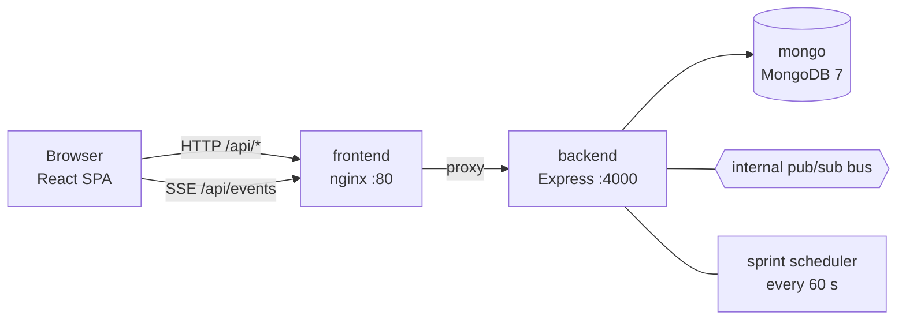
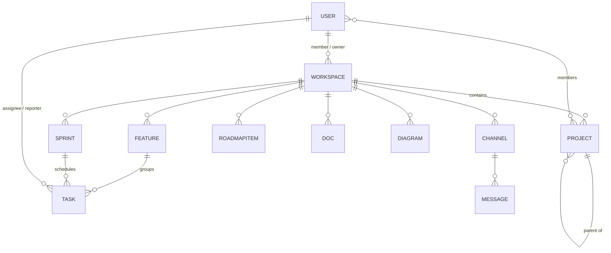
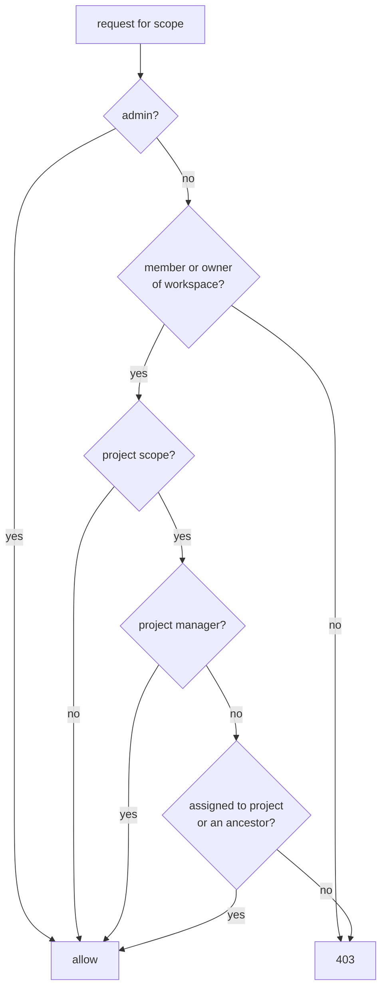
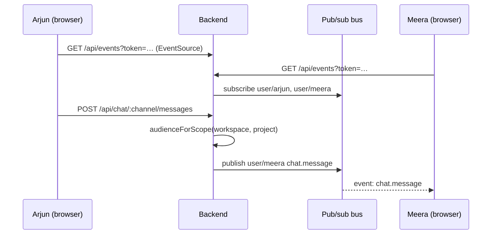

# Architecture

## Containers



- **frontend**: nginx serves the Vite build and proxies `/api`. `/api/events` is proxied unbuffered with a 24 h read timeout.
- **backend**: one Node process holds the REST API, the SSE stream, the pub/sub bus and the scheduler.
- **mongo**: one database per mode (`pmapp` live, `pmapp_demo` demo).

## Data model



Every scoped record (sprint, feature, task, roadmap item, doc, diagram, channel) has:

- `workspace`: always set
- `project`: `null` for workspace level, otherwise the sub-project/module id

Sub-projects and modules are the same `Project` collection. They differ by `kind`, and `parent` builds the tree.

## Access control (`backend/src/access.js`)



*project manager?* in the diagram means the user's role has `projects.view_all`.

### Permissions

Roles live in the `roles` collection and are cached in memory (`auth.js` → `roleCache`, refreshed on every role change). Routes check permissions, never role names:

```js
router.post('/', requirePerm('workspace.create'), …)   // route guard
if (!can(req.user, 'tasks.status.any')) …               // inline check
```

| Area | Permission |
|---|---|
| Users / roles | `users.manage`, `roles.manage` |
| Workspaces | `workspace.create`, `workspace.delete`, `structure.manage`, `projects.view_all` |
| Sprints, features, roadmap | `planning.manage` |
| Tasks | `tasks.manage`; status: `tasks.status.any` or `tasks.status.own` (assignee) |
| Docs & diagrams | `docs.write`; delete others': `docs.delete.any` (authors may delete their own) |
| Chat | `chat.write` |
| Sprint analysis | `reports.view`, CSV: `reports.export` |

The catalog and built-in role defaults are in `backend/src/permissions.js`. Built-in roles are created at startup if missing; edits made on the Roles page are kept. The `admin` key always resolves to every permission.

## Realtime (`backend/src/events.js`)



- Topics are per user (`user/<id>`).
- Scope events are resolved to the users who can see the scope at publish time, so a membership change applies to the very next event.
- Events: `chat.message`, `task.assigned`, `task.updated`, `scope.changed`.
- **Scaling out**: the bus is an in-process `EventEmitter`. To run more than one backend container, replace it with Redis pub/sub or an MQTT broker (Mosquitto, or Aedes embedded). Only `events.js` changes.

## Recurring sprints (`backend/src/scheduler.js`)

Every 60 seconds:

1. `planned` sprints whose start date has passed become `active`.
2. Sprints whose end date has passed become `completed`.
3. For a completed sprint with `recurrence.enabled` and not yet `spawnedNext`:
   - create the next sprint (same length, name numbered +1),
   - if `carryOver` is on, move unfinished tasks into it,
   - mark `spawnedNext`.

## Demo vs live

`APP_MODE` is read in `backend/src/index.js`:

| | demo | live |
|---|---|---|
| Seeds `demo.js` on an empty DB | ✓ | |
| `/api/config` returns demo accounts | ✓ | empty |
| `POST /api/demo/reset` | ✓ (admin) | 404 |
| Requires `JWT_SECRET` ≥ 16 chars | | ✓ |
| Requires `ADMIN_PASSWORD` for the first admin | | ✓ |

The frontend reads `/api/config` on load (`src/config.jsx`). It uses the result for the login-screen accounts, the sidebar mode badge and the reset button.

## Source map

```
backend/src
  index.js            wiring, APP_MODE, admin seed, /api/config, /api/demo/reset
  models.js           all Mongoose schemas
  auth.js             JWT, requireAuth, requireRole, isManager
  access.js           visibility rules, descendantIds, audienceForScope
  events.js           pub/sub bus → SSE
  scheduler.js        sprint activation and rollover
  demo.js             demo dataset + reset
  seed-demo.js        CLI for the demo dataset
  services/users.js   delete-and-delegate
  permissions.js      permission catalog + built-in roles
  routes/
    scoped.js         generic CRUD for scoped collections
    tasks.js          tasks + /mine, /status, /comments, notifications
    sprintReports.js  sprint analysis, velocity, CSV exports
    roles.js          custom roles
    workspaces.js     workspaces, members, visible projects
    projects.js       sub-projects / modules
    users.js          user admin
    chat.js           channels and messages
    dashboard.js      aggregations for charts
    events.js         SSE endpoint
    auth.js           login, me
frontend/src
  main.jsx            providers: Router → Config → Auth → Tour
  App.jsx             shell, sidebar, routes
  api.js              fetch wrapper, constants
  auth.jsx            session, SSE client, toasts, useLiveEvent
  config.jsx          demo/live config
  components/ui.jsx   Modal, Field, Badge, Avatar, MemberPicker, Progress
  components/Tour.jsx guided tour
  components/SprintReport.jsx  sprint analysis modal
  pages/              Login, Home, Users, Roles, MyTasks, ScopeView
  tabs/               Dashboard, Tasks, Features, Sprints, Roadmap, Docs, Diagrams, Chat, Structure
```
